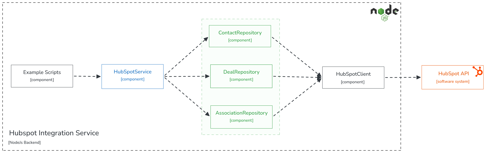

# HubSpot CRM Integration Service

> A modular, production-ready Node.js service for integrating with the HubSpot CRM API, featuring resilient HTTP communication, layered domain architecture, and idempotent batch synchronization.

[](https://nodejs.org/)
[](LICENSE)
[](https://nodejs.org/api/test.html)

---

## Overview

This repository provides a clean, production-oriented Node.js integration with HubSpot CRM (v3 API). It implements a layered architecture to manage Contacts, Deals, Pipelines, and Associations against a live HubSpot portal.

All operations communicate directly with real HubSpot endpoints, handling real-world distributed API challenges:
- **Resilient HTTP Client**: Axios interceptors implementing exponential backoff, full jitter, dynamic `Retry-After` header parsing, and retry handling for `429` (rate limits) and transient `5xx` server errors.
- **Idempotent Batch Upsert**: High-throughput synchronization of Contacts (keyed by email) and Deals (keyed by a custom unique `sync_external_id`), eliminating duplicate creation without relying on delayed Search indexing.
- **Layered Clean Architecture**: Strict separation of concerns across configuration, HTTP transport, domain repositories, orchestration services, and executable CLI scripts.
- **Native Test Suite**: Comprehensive unit testing of payload validation, chunking, backoff calculations, and stream transformations using the built-in `node:test` runner.

---

## Architecture



The application enforces a strict unidirectional flow: CLI consumers call `hubSpotService`, which coordinates domain rules and delegates data persistence to specialized repositories, interacting with HubSpot exclusively through `hubSpotClient`.

- **`config/`**: Centralized environment loader that fails fast on startup if mandatory credentials (`HUBSPOT_ACCESS_TOKEN`) are missing.
- **`clients/`**: `hubSpotClient.js` configures the Axios instance, injects authentication headers, sets network timeouts (10s), and attaches retry interceptors powered by `handleHubSpotErrors.js`.
- **`repositories/`**: Domain-specific data layers (`contactRepository`, `dealRepository`, `associationRepository`) that normalize HubSpot's nested `{ id, properties: { ... } }` schemas, manage pagination cursors, and handle raw batch API limits.
- **`services/`**: `hubSpotService.js` orchestrates business logic, provides deal stage/pipeline fallbacks, and conducts chunked batch sync operations.
- **`utils/`**: Pure functions for payload validation (`validateHubSpotPayload`), error classification & backoff calculation (`handleHubSpotErrors`), array chunking (`chunk`), and transform streams (`streams`).
- **`examples/`**: Executable CLI scripts showcasing individual CRM operations with live console output.
- **`fundamentals/`**: Core Node.js demonstrations covering asynchronous paradigms (callbacks, Promises, async/await), CommonJS modules, and stream pipelines.

```
src/
├── clients/        # Axios HTTP client with retry interceptor, backoff & error classification
├── config/         # Environment variables & fail-fast configuration loader
├── examples/       # Standalone CLI executable scripts for CRM operations
├── fundamentals/   # Demonstrations of asynchronous patterns, CommonJS & Streams
├── repositories/   # Low-level HubSpot API wrappers (Contacts, Deals, Associations)
├── services/       # Domain orchestration service (idempotency, defaults & validation)
└── utils/          # Error classifiers, backoff calculators, payload validators & stream transforms
data/               # Sample seed JSON files for batch synchronization
test/               # Unit test suites executed with node:test
```

---

## Getting Started

### Prerequisites

- Node.js 20+
- A HubSpot Portal with Developer access (Service Keys)

### Installation

```bash
git clone https://github.com/RonyOz/hubspot-crm-integration-nodejs.git
cd hubspot-crm-integration-nodejs
npm install
cp .env.example .env
```

### Environment Configuration

Configure `.env` with your HubSpot portal settings:

| Variable | Description | Default |
|:---|:---|:---|
| `HUBSPOT_ACCESS_TOKEN` | HubSpot Service Key Bearer token (`pat-...`) | *Required* |
| `HUBSPOT_PIPELINE_ID` | Internal deal pipeline ID | `default` |
| `HUBSPOT_STAGE_ID` | Internal deal stage ID | `appointmentscheduled` |
| `HUBSPOT_MAX_RETRIES` | Maximum retry attempts for transient errors | `3` |
| `HUBSPOT_RETRY_BASE_DELAY_MS` | Initial delay in ms for exponential backoff | `500` |

### HubSpot Portal Setup

1. **Service Key Creation**:
   - In HubSpot, navigate to **Development** → **Keys** → **Service keys** → **Create service key**.
   - Grant the following scopes:
     - `crm.objects.contacts.read`
     - `crm.objects.contacts.write`
     - `crm.objects.deals.read`
     - `crm.objects.deals.write`
   - Copy the generated token (`pat-...`) into `HUBSPOT_ACCESS_TOKEN`.

2. **Custom Unique Property for Deals (Idempotent Sync)**:
   - HubSpot enforces uniqueness natively for Contacts via `email`, but Deals lack a default unique key.
   - Navigate to **Settings** → **Objects** → **Deals** → **Properties** → **Create property**.
   - Create a property named `sync_external_id` (Field type: Single-line text).
   - Under advanced settings, check **Require unique values for this property**.
   - *This allows the batch upsert endpoint to safely match incoming records without duplicates.*

3. **Retrieve Pipeline & Stage IDs**:
   - Run `node src/examples/list-pipelines.js` to inspect your portal's deal pipelines and update `HUBSPOT_PIPELINE_ID` and `HUBSPOT_STAGE_ID` accordingly.

---

## Usage & CLI Scripts

All CLI scripts interact directly with the live HubSpot API.

### Contact Management

| Command | Action |
|:---|:---|
| `node src/examples/list-contacts.js [limit]` | List contacts with pagination support |
| `node src/examples/list-contact-names.js` | Fetch all contact names across all pages |
| `node src/examples/create-contact.js [firstname lastname email]` | Create a single contact |
| `node src/examples/update-contact.js <id> [firstname] [lastname] [email]` | Update an existing contact by ID |
| `node src/examples/delete-contact.js <id>` | Delete a contact by ID |

### Deal Management

| Command | Action |
|:---|:---|
| `node src/examples/list-pipelines.js` | List deal pipelines and stages with internal IDs |
| `node src/examples/list-deals.js [limit]` | List deals with pagination support |
| `node src/examples/create-deal.js [dealname amount]` | Create a deal (uses default pipeline/stage) |
| `node src/examples/update-deal.js <id> [dealname] [amount]` | Update deal properties by ID |
| `node src/examples/delete-deal.js <id>` | Delete a deal by ID |

### Associations & Batch Synchronization

| Command | Action |
|:---|:---|
| `node src/examples/associate-contact-deal.js <contactId> <dealId>` | Idempotently associate a contact with a deal |
| `node src/examples/sync-contacts.js` | Batch upsert contacts from `data/contacts.json` (keyed by email) |
| `node src/examples/sync-deals.js` | Batch upsert deals from `data/deals.json` (keyed by `sync_external_id`) |

### Core Node.js Demos

| Command | Description |
|:---|:---|
| `node src/fundamentals/callback.js` | Asynchronous callback pattern using `setTimeout` |
| `node src/fundamentals/asyncAwait.js` | Refactored asynchronous flow using Promises and `async`/`await` |
| `node src/fundamentals/main.js` | CommonJS module export and consumption |
| `node src/utils/streams.js` | Stream pipeline processing (`Readable` → `Transform` → `stdout`) |

---

## Architectural Decisions & Design Rationale

### 1. Deterministic Idempotent Synchronization
- **Contacts**: Upserted via HubSpot's `batch/upsert` endpoint using `idProperty: email`.
- **Deals**: The HubSpot Search API suffers from write-to-index lag (several seconds). Synchronizing by searching first resulted in race conditions and duplicate records on rapid re-runs. To resolve this, synchronization uses `batch/upsert` bound to the unique custom property `sync_external_id` (storing the source record's ID). Back-to-back runs cleanly report `created` followed by `updated` with zero duplicates.

### 2. Resilient Error Handling & Rate Limiting
- **Client-Side Validation**: `validateHubSpotPayload` validates required schemas before any HTTP request is dispatched, preventing malformed requests from consuming API quota.
- **Transient Failures & Backoff**: Network timeouts (10s) and HTTP `500`, `502`, `503`, `504` errors trigger retries with exponential backoff and random jitter.
- **Rate Limit Throttling (`429`)**: The client dynamically respects `Retry-After` headers when provided by HubSpot; otherwise, it doubles delay per retry up to `HUBSPOT_MAX_RETRIES`.
- **Non-retryable Errors**: Client errors (`400`, `401`, `403`, `404`) fail immediately without useless retries.

### 3. Batching & Partial Failure Strategy
- Both contact and deal synchronizations split datasets into chunks of 100 records (HubSpot's strict batch limit).
- Input records without required identity keys (`email` or `source_id`) are filtered before network dispatch and reported in `skippedRecords`.
- Chunk outcomes summarize created/updated record counts and capture batch-level rejection details cleanly.

### 4. Direct HTTP Client vs. SDK
- Instead of using `@hubspot/api-client`, this project uses a configured Axios instance. This enables explicit control over interceptor pipelines, granular timeout management, header redaction in logging, and customized retry policies tailored to real-world integration requirements.

---

## Testing

Run unit tests using the Node.js built-in test runner:

```bash
npm test
```

Unit tests focus on deterministic, non-network business logic:
- Payload schema validation (`validateHubSpotPayload`)
- Error classification and backoff delay computations (`handleHubSpotErrors`)
- Array chunking and boundary handling (`chunk`)
- Stream transformation and error propagation (`streams`)

---

## Production Considerations

- **High Volume**: For enterprise-scale datasets, input loading should transition from in-memory arrays to streaming JSON parsers (`stream/promises`), with rate-limit budgeting tied to `X-HubSpot-RateLimit-*` headers.
- **Two-Way Synchronization**: When bidirectional updates occur, compare `hs_lastmodifieddate` before writes and establish authoritative conflict-resolution policies.
- **Monitoring & Auditing**: Sync execution summaries should be persisted to an audit datastore rather than standard console logging.
